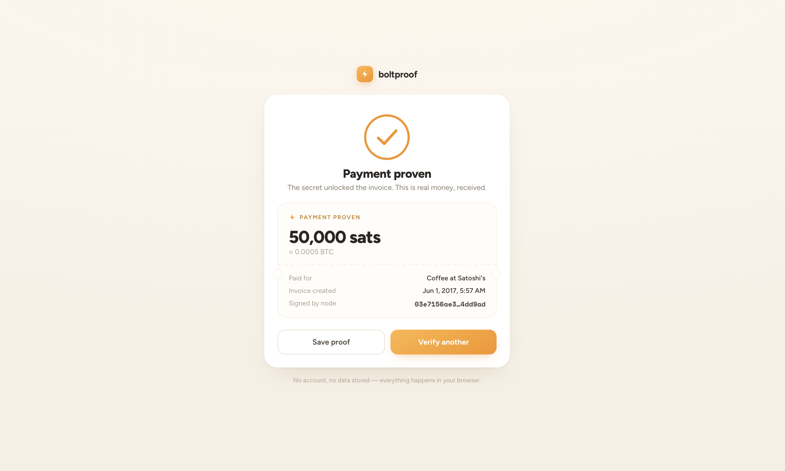

# boltproof

Check whether a Lightning invoice was paid, in your browser. No account. The invoice and preimage are never transmitted.

**[boltproof.app](https://boltproof.app)**



## What it does

Paste a BOLT11 invoice and a payment preimage. boltproof checks that:

1. The invoice signature is valid. That authenticates the node that signed the invoice, not a payer.
2. `sha256(preimage)` matches the payment hash in the invoice.

If both pass, the invoice was paid, not who paid. The recipient created the preimage, forwarding nodes can learn it when the payment settles, and anyone who knows it can present it. An invoice with no amount does not prove how much was paid.

BOLT11 invoices are bech32. The invoice must be entirely lowercase or entirely uppercase; mixed case is rejected. An all-uppercase invoice is accepted. A `lightning:` prefix is not part of the bech32 string, so its own casing is ignored.

## Who it's for

- Merchants and freelancers checking that an invoice was paid before they rely on it
- Anyone who wants that check saved as a text file

## Privacy

The invoice and preimage are checked in your browser and are never transmitted or stored by boltproof. Opening the page loads fonts from Google Fonts. That request does not include the invoice or preimage.

The saved proof file contains the invoice and preimage. Treat it as sensitive.

## Run locally

```bash
npm install
npm run dev
```

Build for production:

```bash
npm run build
```

Run tests:

```bash
npm test
```
